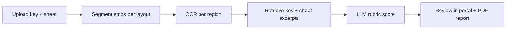

# GRADE

**GRADE (Generalized Recognition and Automated Document Evaluator) grades handwritten exam answer sheets for teachers.**
Marking open-ended handwritten answers is slow and inconsistent. GRADE splits each scanned sheet into answer regions, reads the
handwriting with OCR, pairs each region with its answer-key question by position, and scores every question against a rubric
with an LLM (with retrieved key and sheet excerpts as extra evidence), so the
examiner reviews and corrects grades instead of producing them from scratch.

- **Ingest**: answer keys as Word `.docx`, JSON or text PDF; student sheets as PDF or image.
- **Read**: finds where each answer starts from the marking scheme and the margin labels (no preset needed), then tiered OCR
  (Google Vision first; Azure, PaddleOCR, TrOCR as fallbacks).
- **Score**: rubric grading with Gemini, OpenRouter as fallback, similarity score when the LLM is off; retrieval (pgvector + full-text
  over `rag_chunks`) adds key and sheet excerpts to the prompt.
- **Review**: a React portal with region previews, per-question score correction, and a PDF report.

> **Status.** Works end to end on the bundled CIE sample sheets with Google Vision and Gemini configured; runs locally only,
> with no authentication and no measured agreement with human examiners yet. [`docs/product.md`](docs/product.md) says exactly
> what is real today and what is not.



## Start here

| I want to... | Go to |
|---|---|
| Understand what this is and who it is for | [`docs/product.md`](docs/product.md) |
| Run it locally and make my first change | [`docs/getting-started/setup.md`](docs/getting-started/setup.md) |
| Find my way around the repository | [`docs/getting-started/repo-map.md`](docs/getting-started/repo-map.md) |
| Learn the vocabulary (strip, layout, rubric, job...) | [`docs/getting-started/glossary.md`](docs/getting-started/glossary.md) |
| See how the system fits together | [`docs/architecture/overview.md`](docs/architecture/overview.md) |
| Change how sheets are segmented, read or scored | [`docs/features/grading-pipeline.md`](docs/features/grading-pipeline.md) |
| Ship a change (PRs, CI) | [`CONTRIBUTING.md`](CONTRIBUTING.md), [`docs/operations/ci-cd.md`](docs/operations/ci-cd.md) |
| Run or debug a local instance | [`docs/operations/runbook.md`](docs/operations/runbook.md) |
| Report a vulnerability | [`SECURITY.md`](SECURITY.md) |

The full index, by audience, is [`docs/README.md`](docs/README.md).

## Quick start

```bash
cd backend
docker compose up -d                                   # Postgres 16 + pgvector on port 5433
pip install -e ".[api,ocr_google,llm_gemini,dev]"
cp .env.example .env                                   # set GRADE_DATABASE_URL, Vision credentials, Gemini key
PYTHONPATH=src python -c "import autograder.api; from autograder.db import init_db; init_db()"   # once, on a fresh database (importing the API loads .env)
PYTHONPATH=src python -m uvicorn autograder.api:app --host 127.0.0.1 --port 8000

cd ../frontend && npm ci && npm run dev                # http://127.0.0.1:5173
```

Try it with the sample marking schemes and scans in [`backend/cie/`](backend/cie) (exam ids such as `cie-daa`, `cie-dm`).

## The shape of the repository

```
backend/             FastAPI API + the autograder package, tests, scripts, migrations, sample CIE data (local uvicorn on :8000)
frontend/            GRADE Companion, the React 19 + Vite portal (Vite dev server on :5173, or a static build)
scripts/             repository checks run by CI (scripts/ci) and versioned git hooks (scripts/githooks)
docs/                documentation
.github/             CI workflows, templates, CODEOWNERS, Dependabot, branch rulesets
```

| Layer | Technology |
|---|---|
| Preprocessing | OpenCV deskew; automatic answer layout from page OCR lines + margin labels (or a layout the teacher enters) |
| OCR / HTR | Google Cloud Vision, Azure AI Vision, PaddleOCR, TrOCR |
| Retrieval | 128-D embeddings (MiniLM via Sentence-Transformers when installed, deterministic hash otherwise), pgvector + Postgres FTS |
| Scoring | Gemini, OpenRouter fallback, cosine-similarity fallback |
| Backend | FastAPI with background jobs (`/jobs/*`, polled by the UI) |
| Frontend | React 19, React Router 7, Vite 8 |
| Storage | PostgreSQL 16 + pgvector; sheet files and previews under `backend/data/` |
| Report | ReportLab PDF |

`main` is the version that gets demoed and handed in, so work happens on branches off `staging` and goes through a pull request:
read [`CONTRIBUTING.md`](CONTRIBUTING.md) first and run `sh scripts/setup-hooks.sh` once per clone.

## Team

- Md Afeeduddin
- Syed Liyaqat

*B.E. Computer Science Engineering: Academic Mini Project (GRADE v2).*

## License

MIT. See [`LICENSE`](LICENSE).
