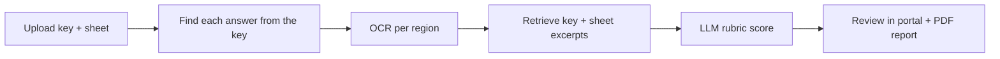

# GRADE

**GRADE (Generalized Recognition and Automated Document Evaluator) grades handwritten exam answer sheets for teachers.**
Marking open-ended handwritten answers is slow and inconsistent. GRADE finds each answer on the scanned sheet using the
marking scheme, reads the handwriting with OCR, and scores every question against a rubric with an LLM (with retrieved key and
sheet excerpts as extra evidence), so the examiner reviews and corrects grades instead of producing them from scratch.

- **Ingest**: answer keys as Word `.docx`, JSON or text PDF (question headers, marks and "answer any 2 of 3" sections are read
  from structured PDFs); student sheets as PDF or image.
- **Read**: finds where each answer starts from the marking scheme and the margin labels (no preset needed), then tiered OCR
  (Google Vision first; Azure, PaddleOCR, TrOCR as fallbacks).
- **Score**: rubric grading with Gemini or OpenRouter (cosine-similarity fallback without an LLM); retrieval (pgvector + full-text
  over `rag_chunks`) adds this question's key and sheet excerpts; choice sections count the best answers only.
- **Review**: a baseline React portal with region previews, per-question score correction, and a PDF report.

> **Status.** A first-pass grader for teachers to review, not a final marker. The testing below covers the GRADE v2 grading
> implementation; the portal UI is a baseline and was not part of it. Verified end to end on 2026-11-09 on one CIE
> sheet (local PaddleOCR + OpenRouter, no layout entered: 6 of 6 answers found, 16.8 / 20), with answer positions checked on two
> more (17 of 18 boundaries right). Answers are matched to questions **by order**, so skipped or out-of-order answers are
> mis-graded; accuracy against human examiners is unmeasured; it runs locally with no authentication.
> [`docs/operations/validation.md`](docs/operations/validation.md) has the evidence and limits;
> [`docs/product.md`](docs/product.md) says what is real today.



## Start here

| I want to... | Go to |
|---|---|
| Understand what this is and who it is for | [`docs/product.md`](docs/product.md) |
| Know what has been tested and how far to trust a grade | [`docs/operations/validation.md`](docs/operations/validation.md) |
| Run it locally and make my first change | [`docs/getting-started/setup.md`](docs/getting-started/setup.md) |
| Find my way around the repository | [`docs/getting-started/repo-map.md`](docs/getting-started/repo-map.md) |
| Learn the vocabulary (strip, layout, rubric, job...) | [`docs/getting-started/glossary.md`](docs/getting-started/glossary.md) |
| See how the system fits together | [`docs/architecture/overview.md`](docs/architecture/overview.md) |
| Change how sheets are segmented, read or scored | [`docs/features/grading-pipeline.md`](docs/features/grading-pipeline.md) |
| Ship a change (PRs, CI) | [`CONTRIBUTING.md`](CONTRIBUTING.md), [`docs/operations/ci-cd.md`](docs/operations/ci-cd.md) |
| Run or debug a local instance | [`docs/operations/runbook.md`](docs/operations/runbook.md) |
| Report a vulnerability | [`SECURITY.md`](SECURITY.md) |

The full index, by audience, is [`docs/README.md`](docs/README.md).

## Quick start

```bash
cd backend
docker compose up -d                                   # Postgres 16 + pgvector on port 5433
pip install -e ".[api,ocr_paddle,dev]"                 # PaddleOCR: needed to find answers automatically; add ocr_google for Vision
cp .env.example .env                                   # set GRADE_DATABASE_URL; GRADE_ENABLE_LLM=true + an OpenRouter or Gemini key
PYTHONPATH=src python -c "import autograder.api; from autograder.db import init_db; init_db()"   # once, on a fresh database (importing the API loads .env)
PYTHONPATH=src python -m uvicorn autograder.api:app --host 127.0.0.1 --port 8000

cd ../frontend && npm ci && npm run dev                # http://127.0.0.1:5173
```

Try it with the sample marking schemes and scans in [`backend/cie/`](backend/cie). Leave the layout empty: answer positions are
detected from the marking scheme. Grading three pages takes about 2-3 minutes on a CPU.

## Before you rely on a grade

It works best when students answer **in question order** with "1st Ans", "2nd Ans"... in the left margin, and the key is a
DOCX, JSON or structured PDF of the same paper. Check each question's box in the evaluator, re-check anything flagged
`review_required` or `region_missing`, and correct scores in place. Details and known limits:
[`docs/operations/validation.md`](docs/operations/validation.md).

## The shape of the repository

```
backend/             FastAPI API + the autograder package, tests, scripts, migrations, sample CIE data (local uvicorn on :8000)
frontend/            GRADE Companion, the React 19 + Vite portal (Vite dev server on :5173, or a static build)
scripts/             repository checks run by CI (scripts/ci) and versioned git hooks (scripts/githooks)
docs/                documentation
.github/             CI workflows, templates, CODEOWNERS, Dependabot, branch rulesets
```

| Layer | Technology |
|---|---|
| Preprocessing | OpenCV deskew; automatic answer layout from page OCR lines + margin labels (or a layout the teacher enters) |
| OCR / HTR | Google Cloud Vision, Azure AI Vision, PaddleOCR, TrOCR |
| Retrieval | 128-D embeddings (MiniLM via Sentence-Transformers when installed, deterministic hash otherwise), pgvector + Postgres FTS |
| Scoring | Gemini or OpenRouter (tested: `google/gemini-2.5-flash-lite`), cosine-similarity fallback; best-n-of-m totals |
| Backend | FastAPI with background jobs (`/jobs/*`, polled by the UI) |
| Frontend | React 19, React Router 7, Vite 8 |
| Storage | PostgreSQL 16 + pgvector; sheet files and previews under `backend/data/` |
| Report | ReportLab PDF |

`main` is the version that gets demoed and handed in, so work happens on branches off `staging` and goes through a pull request:
read [`CONTRIBUTING.md`](CONTRIBUTING.md) first and run `sh scripts/setup-hooks.sh` once per clone.

## Team

- Md Afeeduddin
- Syed Liyaqat

*B.E. Computer Science Engineering: Academic Mini Project (GRADE v2).*

## License

MIT. See [`LICENSE`](LICENSE).
