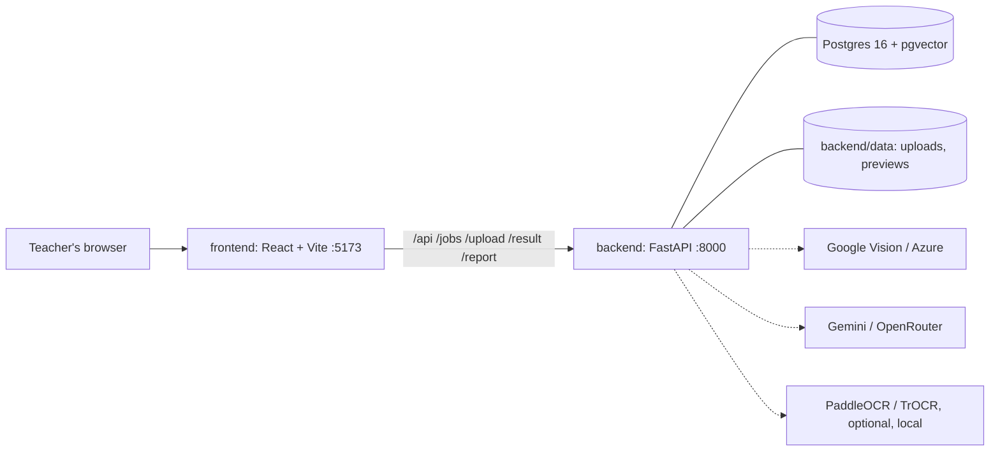

# Architecture overview

> **Audience:** new developers · **Scope:** the whole system, how a request travels, where state lives, what is
> cross-cutting · **Last verified:** 2026-11-08 (checked against `api.py`, `jobs.py`, `evaluation_service.py`, `db.py`)

GRADE is two components and one database. The React portal (`frontend/`) calls the FastAPI service (`backend/`) over HTTP.
The API keeps everything in PostgreSQL with pgvector, except sheet files and page previews, which it writes to
`backend/data/`. Long operations run as background threads inside the API process and are polled by the portal. OCR and
LLM scoring call out to Google Vision / Azure and Gemini / OpenRouter when configured, and fall back to local engines or a
similarity score when not.

## Topology

## How a request travels
1. **Upload.** The portal posts a key and a sheet to `POST /jobs/upload-exam-bundle`. A thread parses the key into
   `answer_keys` (with per-key chunks in `answer_key_chunks`), copies those chunks into `rag_chunks` as `keys_{exam_id}`, and
   saves the sheet file. The sheet is **not** OCRed or indexed at this point.
2. **Evaluate.** `POST /jobs/evaluate` starts `run_evaluation()`. A cached result is returned if the key, layout and prompt
   are unchanged.
3. **Segment.** `preprocess_sheet_for_evaluation()` renders each page, cuts it into strips using the exam's layout, and
   merges strips that belong to the same question. The regions are saved on the sheet for the preview.
4. **Pair and read.** Question *n* is graded against key *n* (positional, not retrieved). Each question patch goes through the OCR tier chain (`ocr.py`).
5. **Retrieve.** Hybrid retrieval adds excerpts from `keys_{exam_id}` and, if the sheet was ever indexed, `sheet_{sheet_id}`.
   Evaluate does not index the sheet itself, so after a portal upload the sheet side is empty.
6. **Score.** `score_answer_llm()` asks Gemini (then OpenRouter) for a rubric JSON, or uses the legacy similarity score.
7. **Persist and show.** The result goes to `evaluation_results` and `sheet_question_answers`; the portal polls
   `GET /jobs/{id}`, then loads `GET /result/{id}`, the page previews, and `GET /report/{id}/pdf`.

## Where state lives
| Store | What is in it | Who writes it |
|---|---|---|
| `sheets` | Sheet metadata, file path, exam, question regions | upload routes, `run_evaluation` |
| `answer_keys`, `answer_key_chunks` | Model answers, max marks, embedded key chunks | key upload routes |
| `rag_chunks` | Embedded key and sheet chunks (`keys_{exam_id}`, `sheet_{sheet_id}`) with full-text index; the only table retrieval reads | `ingest_keys_rag` (every key upload), `ingest_sheet_rag` (sync uploads, `/api/sheet/{id}/ingest`) |
| `evaluation_results` | Per-sheet grades, rubric breakdown, confidence, prompt hash | `run_evaluation`, HITL patch |
| `sheet_question_answers` | Per-question OCR text and extracted answers | `run_evaluation` |
| `jobs` | Background job status, stage, progress, result | `jobs.py` |
| `backend/data/uploads/` | Raw sheet files | upload routes |
| `backend/data/previews/{sheet_id}/` | Page PNGs and `regions.json` | `sheet_preview.py` |

The schema is defined twice: `backend/supabase/migrations/` (for Supabase) and the idempotent statements in `db.py`
(`init_db`). `jobs`, `sheet_question_answers` and the sheet region columns exist **only** in `db.py`.

## Cross-cutting concerns
- **Configuration:** environment variables only, loaded from `backend/.env` by `api._load_dotenv()`; documented in `backend/.env.example`.
- **Auth:** none. CORS is limited to local dev origins (`GRADE_CORS_ORIGINS`).
- **Background work:** daemon threads in the API process (`jobs.start_job_thread`); a restart loses in-flight jobs.
- **Logging:** standard `logging`; no central sink.
