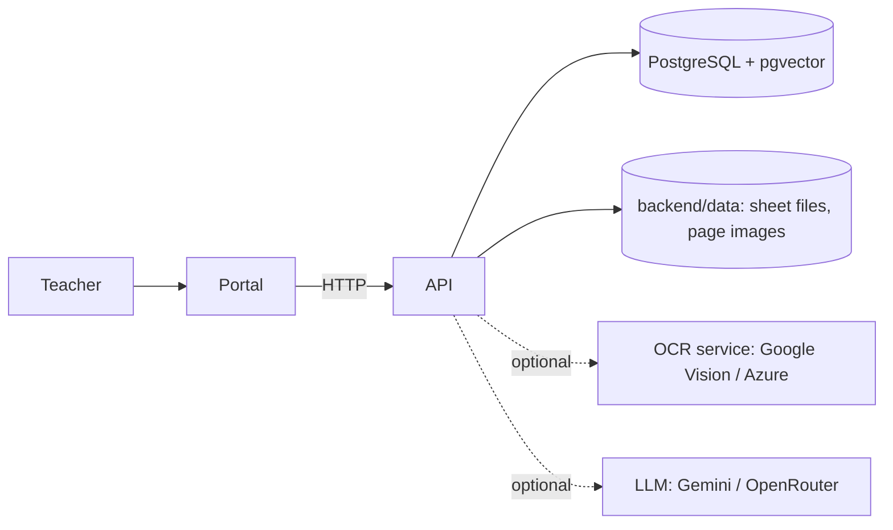
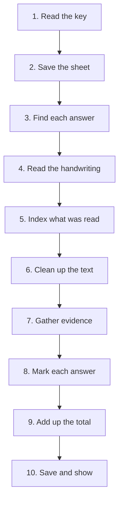

# Architecture overview

> **Audience:** new developers · **Scope:** the parts of GRADE, how a sheet becomes a grade, where data is kept, and the main
> design trade-offs · **Last verified:** 2026-11-09 (checked against `api.py`, `jobs.py`, `evaluation_service.py`,
> `answer_layout.py`, `db.py`)

## In one minute
A teacher uploads a **marking scheme** (the answer key) and a **scanned answer sheet**. GRADE works out where each answer is on
the sheet, reads the handwriting, and asks an LLM to mark each answer against its model answer. The teacher then reviews the
marks in a web portal, corrects any that are wrong, and downloads a PDF report.

It is made of two programs and one database, all running on one machine:

| Part | What it does | Where |
|---|---|---|
| **Portal** (frontend) | The web pages a teacher uses: upload, grade, review, reports. A baseline UI | `frontend/`, React + Vite, port 5173 |
| **API** (backend) | Does all the work: reads keys, finds and reads answers, grades, stores results | `backend/`, FastAPI, port 8000 |
| **Database** | Keys, sheets, results, search index, job progress | PostgreSQL 16 with the pgvector extension |

The API also talks to outside services when they are configured: an OCR service (Google Vision or Azure) and an LLM
(Gemini or OpenRouter). Without them it falls back to local OCR (PaddleOCR, TrOCR) and a simple similarity score.

## The big picture

## How a sheet becomes a grade

Long steps run in the background: the portal starts a **job** and checks its progress every few seconds
(`POST /jobs/...`, then `GET /jobs/{id}`).

1. **Read the key.** The marking scheme (DOCX, JSON or PDF) is split into questions, each with a model answer and maximum
   marks. Structured PDFs also give sub-parts and "answer any 2 of 3" sections. Each model answer is cut into small pieces
   and added to the search index. *Code: `key_docx.py`, `key_pdf.py`, `rag/ingest.py`.*
2. **Save the sheet.** The scanned file is stored. On a portal upload nothing is read yet; that happens when grading starts.
   *Code: `api._save_sheet_bytes`.*
3. **Find each answer.** If the teacher typed a layout (answers per page, e.g. `3,1,2`) it is used. Otherwise GRADE reads every
   page into lines, looks for answer labels in the left margin ("1st Ans", "2nd Ans"), and splits the lines so each group
   reads most like one model answer. An answer may continue onto the next page. A preset is used only if this cannot run.
   *Code: `preprocessing.py`, `answer_layout.py`.*
4. **Read the handwriting.** Each answer region is read once by the first OCR engine that works (Google Vision, Azure,
   PaddleOCR, TrOCR). *Code: `ocr.py`.*
5. **Index what was read.** That text replaces the sheet's entry in the search index, so later steps always see the same
   text that is being marked. *Code: `rag/ingest.index_sheet_ocr`.*
6. **Clean up the text.** Obvious OCR mistakes are fixed. If an LLM is configured it may tidy the text too, but it never sees
   the model answer, and any rewrite that borrows the key's wording is thrown away. *Code: `text_format.py`.*
7. **Gather evidence.** For each question, the search index supplies matching pieces of *that* question's model answer and of
   the student's text. *Code: `rag/retrieval.py`.*
8. **Mark each answer.** Answer *n* is marked against question *n*. The LLM gets the model answer, the student's answer and
   the evidence, and returns marks, rubric scores and feedback. With no working LLM a similarity score is used and labelled
   `fallback-legacy`. *Code: `scoring.py`, `prompts/grading_v2.txt`.*
9. **Add up the total.** Choice sections count only the best answers ("any 2 of 3"), so the maximum matches the printed paper.
   Questions with no answer found are listed with 0 marks and flagged `region_missing`. *Code: `totals.py`.*
10. **Save and show.** The grade, each answer's text and the answer regions are saved; the portal shows each region on the page
    image, lets the teacher correct a mark (the total is recalculated), and offers a PDF. *Code: `evaluation_service.py`,
    `sheet_preview.py`, `report_pdf.py`.*

A sheet that was already graded is not graded again unless the teacher asks (`force_regrade`), the number of questions
changed, or a different layout was requested.

## Where data is kept
| What | Where | Written when |
|---|---|---|
| Questions, model answers, marks, sections | `answer_keys` (+ pieces in `answer_key_chunks`) | a key is uploaded |
| Uploaded sheets and where each answer is | `sheets` (answer regions in `question_regions`); files in `backend/data/uploads/` | upload; every grading run |
| Search index (key pieces and the student's text) | `rag_chunks`, one group per exam key (`keys_{exam_id}`) and per sheet (`sheet_{sheet_id}`) | key upload; every grading run |
| Each answer's text as read and cleaned | `sheet_question_answers` | every grading run |
| Grades, rubric scores, feedback, flags | `evaluation_results` | every grading run; teacher corrections |
| Job progress | `jobs` | while a job runs |
| Page images with answer boxes | `backend/data/previews/{sheet_id}/` | after grading |

The table definitions live in `db.py` (`init_db`), with matching SQL files in `backend/supabase/migrations/` for Supabase.
`jobs`, `sheet_question_answers` and `sheets.question_regions` exist only in `db.py`
([ADR 0003](decisions/0003-schema-in-init-db-and-migrations.md)).

## Design choices and their costs
| Choice | Why | Cost |
|---|---|---|
| Answers are matched to questions **by order** | simple and reliable when students answer in order | a skipped or out-of-order answer is marked against the wrong question ([validation](../operations/validation.md#known-limits)) |
| Answer positions come from the key, not presets | presets were wrong for some sheets ([ADR 0004](decisions/0004-automatic-answer-layout-over-presets.md)) | each page is read once more; needs PaddleOCR |
| The text being marked is the text that is indexed | evidence and answer never disagree | the index is rebuilt on every grading run |
| Background jobs are threads inside the API | no extra services to run | restarting the API abandons running jobs |
| Everything runs locally | an academic project with student data | no login: never expose the API to the internet |

## Shared concerns
- **Settings:** environment variables only, read from `backend/.env` when the API starts; every variable is listed in
  `backend/.env.example`. Restart the API after changing it.
- **Access:** no authentication. Browsers may call the API only from the local portal addresses (`GRADE_CORS_ORIGINS`), but
  any program that can reach port 8000 can use it, so keep it bound to `127.0.0.1`.
- **Logs:** standard Python logging to the console.

Next: [`../features/grading-pipeline.md`](../features/grading-pipeline.md) for the details of each step ·
[`../operations/validation.md`](../operations/validation.md) for how well it works
